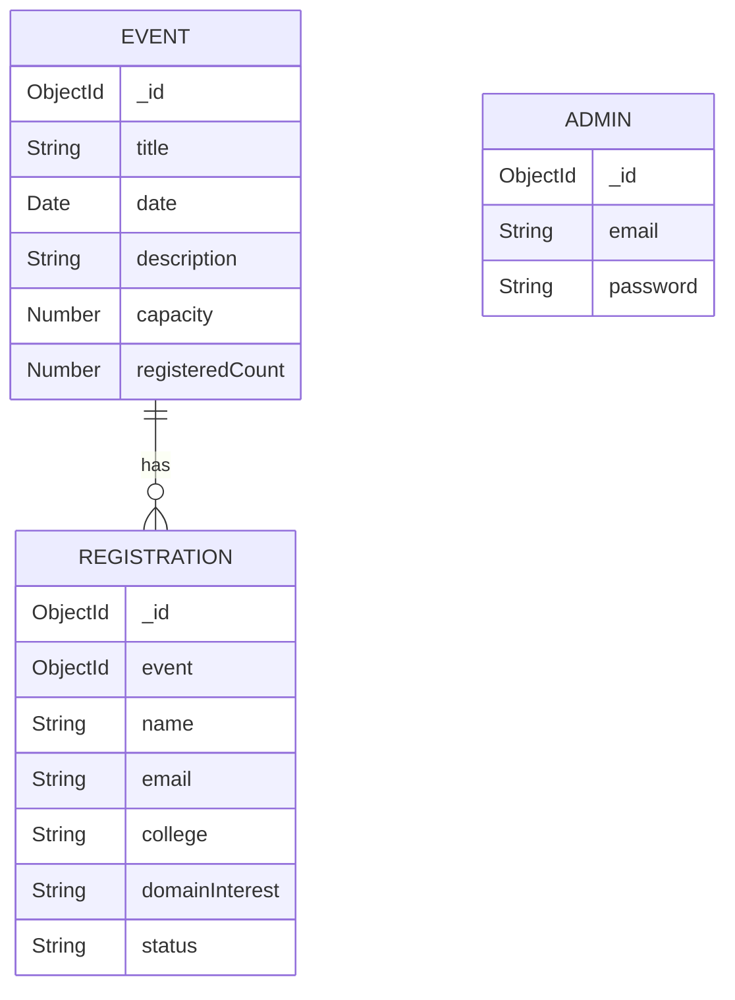

# EventSphere – Event Registration Platform

EventSphere is a MERN stack web application where users can explore upcoming events and register for them. Admins can log in to view and search registered participants.

## Features

### Public Section
- View upcoming events.
- Check event date, description and available seats.
- Register for an event using name, email, college/organization and domain interest.
- Prevent duplicate registration using the same email for the same event.
- Dynamically update the registered participant count.

### Admin Section
- Secure admin login using JWT authentication.
- Protected admin dashboard.
- View all registered participants.
- Search participants by name, email or college.
- View registration status.

## Technology Stack

- Frontend: React.js, CSS, Axios
- Backend: Node.js, Express.js
- Database: MongoDB Atlas, Mongoose
- Authentication: JWT, bcryptjs

## Project Structure

```text
EventSphere/
├── Frontend/
│   ├── src/
│   │   ├── App.jsx
│   │   └── App.css
│   └── package.json
│
├── Backend/
│   ├── config/
│   ├── controllers/
│   ├── middleware/
│   ├── models/
│   ├── routes/
│   ├── seedAdmin.js
│   ├── seedEvents.js
│   ├── server.js
│   └── package.json
│
└── README.md
```

## Database Schema

The application uses three MongoDB collections.

### Event
- title
- date
- description
- capacity
- registeredCount

### Registration
- event (reference to Event)
- name
- email
- college
- domainInterest
- status

### Admin
- email
- password (stored as a bcrypt hash)

### Schema Diagram



A unique compound index on `event` and `email` prevents duplicate registrations for the same event.

## Installation and Setup

### 1. Clone the repository

```bash
git clone YOUR_GITHUB_REPOSITORY_URL
cd EventSphere
```

### 2. Backend setup

```bash
cd Backend
npm install
```

Create a `.env` file inside the Backend folder:

```env
PORT=5000
MONGO_URI=your_mongodb_connection_string
JWT_SECRET=your_secret_key
ADMIN_EMAIL=your_admin_email
ADMIN_PASSWORD=your_admin_password
```

### 3. Seed the database

Run these commands from the Backend folder:

```bash
node seedAdmin.js
node seedEvents.js
```

### 4. Start the backend

```bash
npm run dev
```

### 5. Frontend setup

Open another terminal:

```bash
cd Frontend
npm install
npm run dev
```

Open the local URL displayed by Vite in your browser.

## API Endpoints

| Method | Endpoint | Description |
|---|---|---|
| GET | /api/events | Get all events |
| POST | /api/events | Create event (Admin) |
| POST | /api/registrations | Register participant |
| POST | /api/admin/login | Admin login |
| GET | /api/admin/registrations | View/search registrations (Admin) |

Duplicate registration returns HTTP `409 Conflict`.

## Screenshots

Add the following screenshots to a `screenshots` folder:

1. Event showcase page
2. Participant registration form
3. Admin login page
4. Admin dashboard with registered participants

## Security Notes

- Admin passwords are hashed using bcryptjs.
- JWT authentication protects admin routes.
- Environment variables are used for database credentials and authentication secrets.
- The `.env` file should never be uploaded to GitHub.

## Author

**Sayantika Das**

GitHub: [sayantikadas06](https://github.com/sayantikadas06)

Developed as part of the CodeNova Full Stack Development Internship.